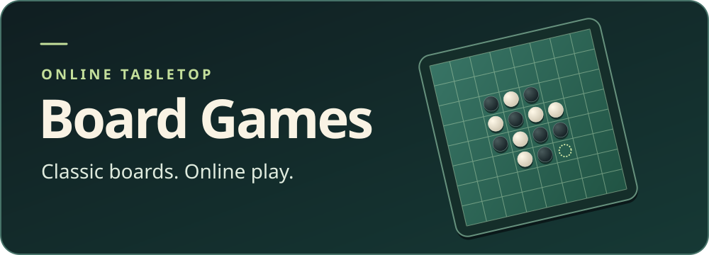

# Board Games

Classic strategy board games you can play online. We’re starting with Reversi and Gomoku.

익숙한 전략 보드게임을 온라인으로 옮깁니다. 첫 프로젝트는 리버시와 오목입니다.

## Reversi · 리버시

Flip discs on a 3D board. Share an invite link to play a friend, or join the quick-match queue for a one-on-one game.

3D 보드에서 돌을 뒤집어 판을 가져오는 1대1 게임입니다. 링크로 친구를 초대하거나 빠른 대전에 참가할 수 있습니다.

**[Open the web preview · 웹 체험판 열기](https://othello.mint.surf/)**

The Android version is in testing. · Android 버전은 테스트 중입니다.

## Arena · 오목

An online Gomoku project. Place five stones in a row before your opponent does.

상대보다 먼저 돌 다섯 개를 한 줄에 놓는 온라인 오목 프로젝트입니다.

**[Explore Arena on GitHub · 저장소 보기](https://github.com/Crypto-Board-Games/arena)**
